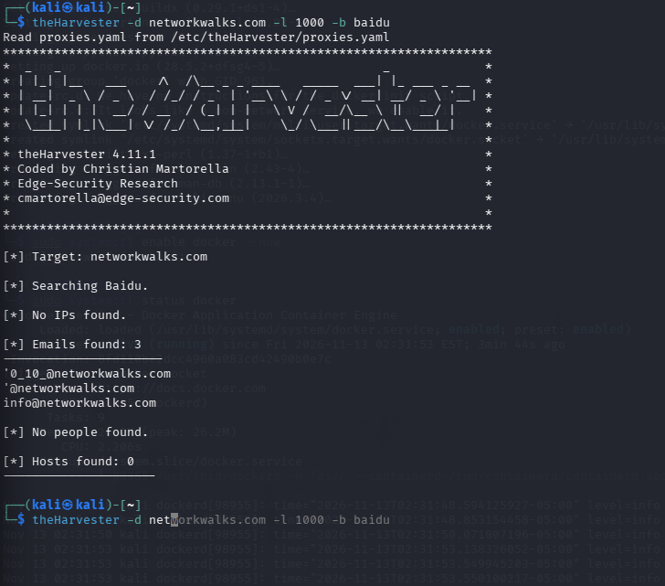
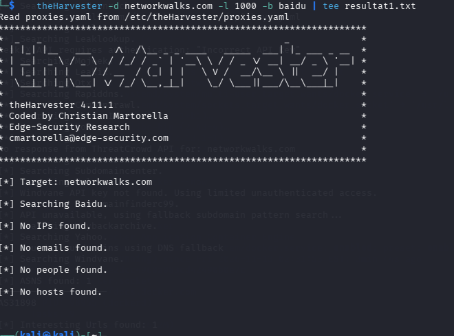
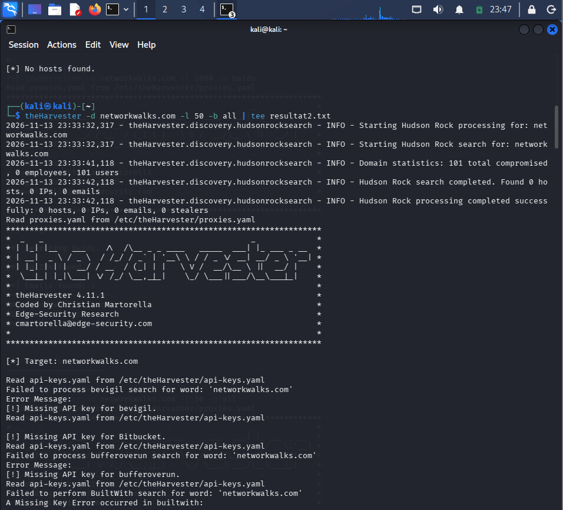
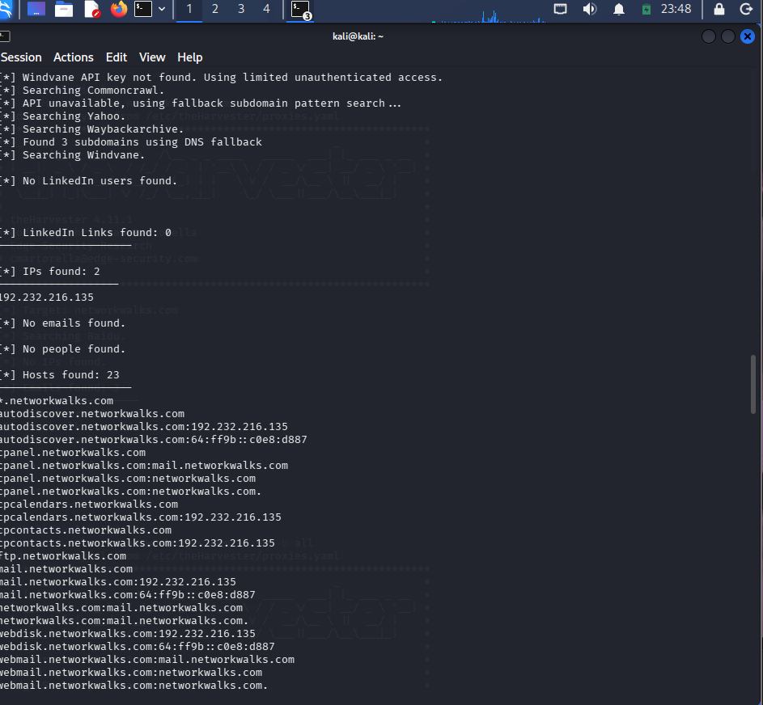
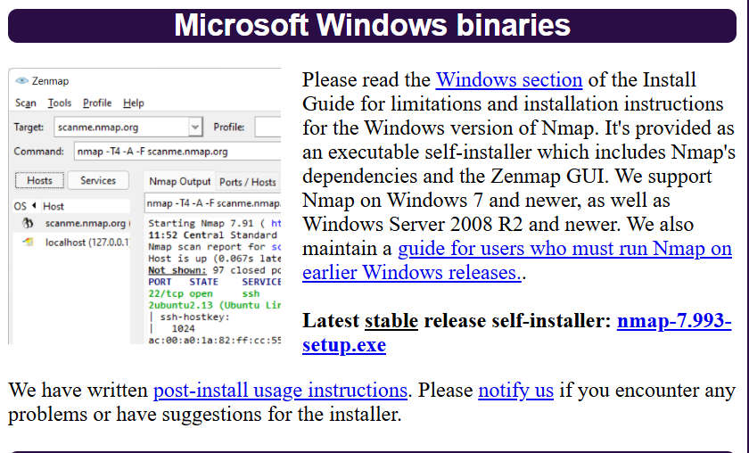
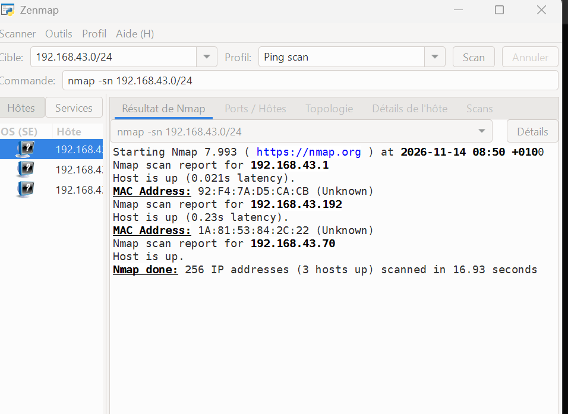
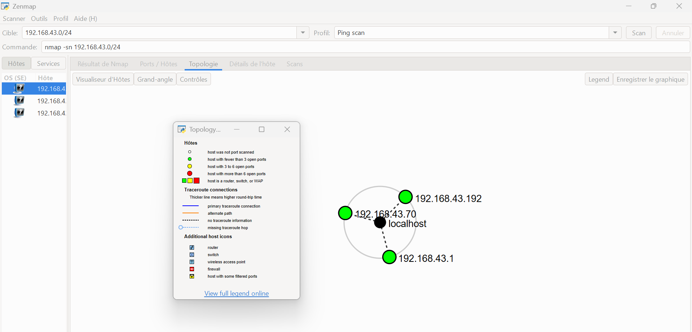

<div align="center">

# 🔎 Footprinting & Network Scanning – Week 2

**Passive reconnaissance with theHarvester and network discovery with Zenmap, documented in a penetration testing report**


</div>

---

## 📌 Project Overview

This repository contains my **Week 2** work of the Networkwalks Cybersecurity Internship (**W2-PM4, W2-PM5 and W2-PM-FINAL**).

The goal was to follow the first two phases of a penetration test:

1. **Reconnaissance & Footprinting:** collect public information about an authorized target domain.
2. **Scanning & Network Discovery:** find the live devices of a network that I own.

The full findings, risk analysis and recommendations are in the **penetration testing report** (`report/` folder). This README gives a short summary and the evidence.

> ⚠️ All activities were done only on a target authorized through the internship program and on my own devices. Nothing was exploited.

---

## 🧩 Modules Completed

| Module | Topic | Status |
|---|---|---|
| **W2-PM4** | Footprinting with theHarvester | ✅ Completed |
| **W2-PM5** | Network scanning with Zenmap | ✅ Completed |
| **W2-PM-FINAL** | Penetration testing report | ✅ Completed |
| W2-PM3 | Footprinting with Maltego | ❌ Not possible (see *Problems & Solutions*) |

---

## 🛡️ Scope & Authorization

| Target | Authorization |
|---|---|
| The Networkwalks domain | Authorized through the internship program (Letter of Authorization) |
| My own local network | A personal mobile hotspot with three devices that I own |
| School Wi-Fi network | **Not scanned.** It is not my network and is outside my authorization |

---

## 🧰 Tools Used

| Tool | Purpose |
|---|---|
| Kali Linux (VirtualBox lab from Week 1) | Reconnaissance environment |
| theHarvester 4.11.1 | Collect emails, hosts, subdomains and IPs from public sources |
| Zenmap (Nmap 7.993) on Windows | Ping scan, MAC addresses and network topology |

---

# 🪜 Activities

## 1. Footprinting with theHarvester (W2-PM4)

**Task 1: Baidu as the only source**

```bash
theHarvester -d <target-domain> -l 1000 -b baidu
```

The result changed between two runs. The first run found 3 email strings (only one looked like a real address, the other two were malformed false positives). The second run, saved with `tee`, found nothing. Baidu is a live search engine and does not answer the same way each time, so I kept both screenshots.





**Task 2: all sources**

```bash
theHarvester -d <target-domain> -l 50 -b all | tee resultat2.txt
```

This run found **23 hosts** and **2 IP addresses**. The host names (for example `cpanel`, `webmail`, `ftp`, `webdisk`, `autodiscover`) suggest a typical cPanel hosting environment. No emails were found, and several sources returned *Missing API key* errors.





## 2. Network scanning with Zenmap (W2-PM5)

The Wi-Fi I was connected to belongs to my school, so I did not scan it. I created my own network instead: my main phone shares its hotspot, my PC and my second phone are connected to it.

I downloaded Nmap with Zenmap for Windows from the official site:



Then I ran a **Ping scan** on my hotspot subnet (`nmap -sn <my-subnet>`). It checked 256 addresses in about 17 seconds and found **3 live hosts**: the phone sharing the hotspot (gateway), my second phone, and my PC. Nmap showed the MAC address of the two other devices, and did not show it for my own PC (it never displays the MAC of the machine it runs on).



The **Topology** tab shows my PC in the center with the other hosts around it. The topology was also saved as a PDF, as required by the practical.



---

# 🔐 Key Findings

| # | Finding | Level |
|---|---|---|
| 1 | Host names and subdomains of the target are publicly discoverable | Medium |
| 2 | Possible exposed user credentials reported by a data source (not verified) | Medium |
| 3 | Server IP address identifiable | Low |
| 4 | A public email address is visible | Low |
| 5 | Live hosts and MAC addresses visible on a local network | Low |

These are observations from information gathering, **not confirmed vulnerabilities**. See the report for the full risk table and the 9 recommendations.

---

# 🐞 Problems Encountered & Solutions

## Problem 1. I could not register for Maltego (W2-PM3)

**Problem:** the Maltego registration form does not list my country (Cameroon). The form says that its products are unavailable in certain countries because of export laws.

**Solution:** I did not use another country to bypass the form, because that would mean giving false information. I used **theHarvester (W2-PM4)** instead, which has the same goal: finding emails and hosts linked to a domain.

## Problem 2. Different results for the same command

**Problem:** the same theHarvester command with Baidu gave 3 emails once and nothing the next time.

**Solution:** I understood that the result depends on a live search engine. I kept both results as evidence, then used the `-b all` option to query all sources, which gave stable and richer results. I also checked the data by hand, because some emails were malformed false positives.

## Problem 3. The only Wi-Fi available was not my network

**Problem:** scanning the school Wi-Fi would show one machine only (mine) and scanning the whole subnet would be outside my authorization.

**Solution:** I created my own test network with my phone hotspot, and connected two devices that I own. The scan then showed three devices, within my authorization.

---

# 💡 What I Learned

1. Public sources can give a lot of information about an organization without touching its systems.
2. Automatic tools can give false positives or different results, so the output must be verified.
3. Some tools are restricted by export rules, and an equivalent tool can reach the same goal.
4. A ping scan shows live hosts and MAC addresses, and modern phones use private (random) MAC addresses.
5. Scope matters: always test only what you own or are authorized to test.
6. A good report explains what was done, what was found, the risk and the fix.

---

# 🔐 Security & Ethical Use

This work is strictly for education. It was done only on a target authorized through the internship program and on devices that I own. Doing the same on other systems without written permission is illegal.

---

# 📂 Repository Content

```
.
├── README.md
├── report/
│   └── W2-PM-FINAL_Penetration_Testing_Report.docx
├── screenshots/       (7 screenshots)
|
└── topology/          (Zenmap topology PDF)
```

---

# 👤 Author

**FOTSO Verdiane**
Cybersecurity Intern – Networkwalks

LinkedIn: *https://www.linkedin.com/in/verdiane-fotso-8b4b1b308/*

---

## 📌 Project Information

**Program Name:** Cybersecurity program at Networkwalks | **Week:** 02 | **Repository:** [GitHub](https://github.com/ver-di40/NETWORKWALKS-FOTSO-BO84L-WK2-PM1-CYBERSECURITY-LAB-SETUP)
